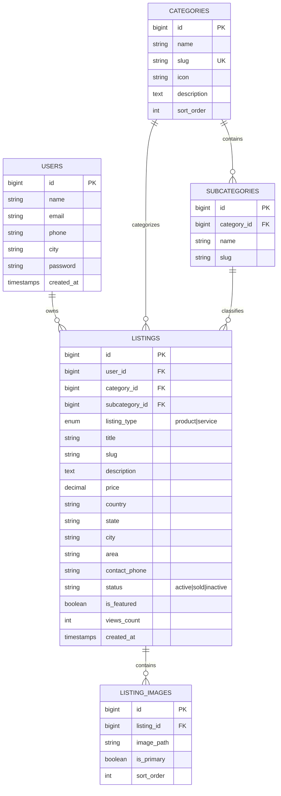

# LocalMarket — Classifieds & Marketplace Platform

A production-minded, responsive classifieds marketplace web application inspired by OLX India. Built with **Laravel 12**, **MySQL**, **Blade**, and **Bootstrap 5** for the **Laravel Developer Internship Assignment** at **Honeybee Digital**.

---

## 🌟 Key Features

### 1. User Authentication & Authorization
- **Registration & Login**: Secure session-based authentication with bcrypt password hashing.
- **Ownership Security**: Robust authorization policies (`ListingPolicy`) ensuring users can only edit or delete their own listings. Unauthorized URL manipulations return HTTP `403 Forbidden`.
- **Guest Access**: Guests can freely browse all listings, view individual item pages, filter by categories, and search across cities.
- **User Dashboard**: Dedicated dashboard displaying user metrics (Total ads, Active ads, Sold ads, Views count), status filters, and instant listing controls.

### 2. Product & Service Listing Management
- **Independent Classification**: Each listing can be classified as a **Product** or **Service** independently of the category hierarchy.
- **Relational Categories & Subcategories**: Fully database-backed categories with dynamic JavaScript updates for subcategories.
- **Location Hierarchy**: Organized fields for Country (default India), State, City, and Locality/Area.
- **INR Pricing**: Non-negative numeric pricing formatted with Indian Rupee symbol (`₹`).
- **Secure File Storage**: Validated image uploads (mimes: jpeg, png, jpg, webp; max 4MB) stored using Laravel's Storage disk (`public/listings`).
- **Atomic Database Transactions**: Listing and image records are created/updated atomically within transactions.

### 3. Route Architecture & Advanced Filtering
- **Home Page (`/`)**: Hero search banner, category grid with live listing counts, featured listings, fresh recommendations, popular cities bar, and local services.
- **Category-Wise Browse (`/category/{category:slug}`)**: Active listings belonging to a selected category (e.g. `/category/electronics-appliances`).
- **City-Wise Browse (`/city/{city}`)**: Active listings belonging to a specific city (e.g. `/city/gwalior`).
- **City + Category Browse (`/city/{city}/{category:slug}`)**: Listings matching **both** the selected city and category applied strictly in the SQL database query.
- **Multi-Faceted Search (`/browse`)**: Real-time filtering by:
  - Keyword search (searches title, description, and locality)
  - Category and subcategory
  - Classification (All, Products, Services)
  - City / Location
  - Price Range (Minimum and Maximum price)
  - Sorting (Newest, Price: Low to High, Price: High to Low, Most Popular)
  - URL Query String Preservation across pagination links (`->withQueryString()`).

### 4. Realistic Indian Classifieds UI/UX
- Authentic OLX-style color palette: Deep navy/dark slate (`#002f34`), vibrant teal accent (`#00a49f`), and Indian marketplace highlight (`#ffce32`).
- 4:3 / 3:2 image cards with badges, INR pricing, location tags, and relative timestamps ("2 days ago").
- Interactive details page with image switcher gallery, seller verification box, contact modal (simulated phone reveal & inquiry sender), and safety guidelines.
- 100% self-contained sample vector illustrations (`storage/app/public/samples/`) preventing external broken images or CDN outages.

---

## 🛠️ Technology Stack

- **Backend Framework**: Laravel 12.x
- **PHP Version**: PHP 8.2+
- **Database**: MySQL 5.7+ / 8.0+ / MariaDB
- **Frontend Engine**: Laravel Blade (Server-rendered components)
- **Styling**: Bootstrap 5.3.3 + Bootstrap Icons 1.11.3 + Custom CSS
- **Fonts**: Google Fonts (*Plus Jakarta Sans*)
- **Storage**: Laravel Storage symlink (`php artisan storage:link`)
- **Testing**: PHPUnit / Laravel Test Suite (15 Automated Feature Tests)

---

## 📁 Database Relational Schema



---

## 🚀 Installation & Setup Instructions

### 1. Prerequisites
Ensure you have installed:
- PHP 8.2 or higher with `pdo_mysql`, `curl`, `mbstring`, `openssl`, and `gd` extensions enabled.
- Composer 2.x
- MySQL server (e.g. via WampServer, XAMPP, or standalone MySQL service).

### 2. Clone or Enter Project Directory
```bash
cd c:\wamp64\www\assisment
```

### 3. Install Dependencies
```bash
composer install
```

### 4. Environment Configuration
Copy the environment template:
```bash
cp .env.example .env
```
Ensure your database credentials in `.env` match your local MySQL configuration:
```ini
APP_NAME=LocalMarket
APP_ENV=local
APP_KEY=base64:UMNor+miKe93lgn9YeCq2yXQmBFg67F6Jbi+Ur9s+5o=
APP_URL=http://localhost:8000

DB_CONNECTION=mysql
DB_HOST=127.0.0.1
DB_PORT=3306
DB_DATABASE=localmarket
DB_USERNAME=root
DB_PASSWORD=

FILESYSTEM_DISK=public
```

If you need a new application key:
```bash
php artisan key:generate
```

### 5. Create Database & Run Migrations
Create the `localmarket` database in MySQL if it doesn't already exist:
```sql
CREATE DATABASE IF NOT EXISTS `localmarket` CHARACTER SET utf8mb4 COLLATE utf8mb4_unicode_ci;
```

Run migrations:
```bash
php artisan migrate
```

### 6. Link Public Storage
To allow browser access to uploaded listing images:
```bash
php artisan storage:link
```

### 7. Seed Categories and Demo Listings
Run the database seeders to populate realistic categories, subcategories, demo users, and Indian marketplace listings:
```bash
php artisan db:seed
```

### 8. Run the Development Server
```bash
php artisan serve --port=8000
```
Open your browser and navigate to: **`http://127.0.0.1:8000`**

---

## 🔑 Demo Login Credentials

The database seeder creates several realistic user accounts for testing:

| Role | Email | Password | City |
|---|---|---|---|
| **Seller (Gwalior)** | `rahul@example.com` | `password123` | Gwalior |
| **Seller (Indore)** | `priya@example.com` | `password123` | Indore |
| **Seller (Bhopal)** | `amit@example.com` | `password123` | Bhopal |
| **Seller (Delhi)** | `demo@localmarket.in` | `password123` | Delhi |

*(A handy "Use" button is also provided directly on the Login page to prefill credentials instantly)*.

---

## 🧪 Automated Testing

A comprehensive test suite is provided in `tests/Feature/MarketplaceTest.php` covering all assignment requirements.

Run all tests via:
```bash
php artisan test
```

### Verified Test Cases:
1. `✓ that true is true` (Unit)
2. `✓ the application returns a successful response` (Homepage)
3. `✓ user can register login and logout`
4. `✓ guest cannot create edit or delete listings` (Redirects to login)
5. `✓ authenticated user can publish product listing`
6. `✓ authenticated user can publish service listing`
7. `✓ invalid listing submission fails with errors` (Server-side validation)
8. `✓ category filtering returns correct results` (`/category/electronics-appliances`)
9. `✓ city filtering returns correct results` (`/city/gwalior`)
10. `✓ city plus category filtering applies both conditions` (`/city/gwalior/electronics-appliances`)
11. `✓ user cannot edit or delete another users listing` (HTTP 403 Forbidden)
12. `✓ owner can update and delete own listing`
13. `✓ invalid category returns 404`
14. `✓ combined filters work together` (Keyword + Price Range + Type)
15. `✓ dashboard status toggle` (Active <-> Sold)

**Test Result:** `15 passed (68 assertions)` with 0 errors.

---

## 📹 Manual Demonstration Sequence (For Video Recording)

When recording your submission walkthrough video, follow this recommended sequence:

1. **Homepage Walkthrough (`http://127.0.0.1:8000`)**:
   - Showcase the clean, OLX-style interface, header, location dropdown, and category icons.
   - Point out realistic listings with INR pricing (`₹ 74,500`, `₹ 5,25,000`, `₹ 600`), location tags, and badges.
2. **City & Category Filtering**:
   - Click on **Gwalior** in the popular cities section -> show URL `/city/gwalior` filtering to Gwalior listings only.
   - Navigate to `/city/gwalior/electronics-appliances` -> highlight how both conditions are applied in SQL query.
   - Test the search bar with keyword `MacBook` or `Swift` and adjust price filters.
3. **Listing Details Page**:
   - Open any listing (e.g. MacBook Air M2).
   - Demonstrate the image thumbnail gallery switcher, full description, seller profile box, and the **Contact Seller** modal with simulated inquiry sending and phone reveal.
4. **Authentication & User Dashboard**:
   - Click **Login** and click the demo helper button for `rahul@example.com` / `password123`.
   - Show the **Dashboard**: view active listings, views count, and toggle a listing's status to **Sold** and back to **Active**.
5. **Publish a New Listing ("SELL" flow)**:
   - Click the prominent **+ SELL** button.
   - Select classification: **Product** or **Service**.
   - Select Category (e.g. *Mobiles & Tablets*) -> show how Subcategories update instantly.
   - Fill in title, description, price, city (*Gwalior*), and upload photo(s) -> see live thumbnail previews.
   - Click **Post Ad Now** -> confirm instant redirect to the live listing page with success alert.
6. **Authorization Security Check**:
   - Show that Rahul can edit his own listing.
   - Explain that unauthorized users attempting to modify or delete another seller's listing receive an HTTP 403 Forbidden response.
